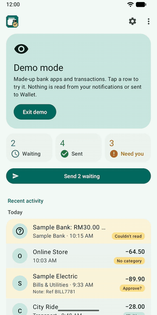

# Bank to Wallet

[](https://github.com/Atsukio/bank-to-wallet-sync-apk/actions/workflows/ci.yml)


[](LICENSE)

> **A note on this project:** I built this for my own use. If it fits your needs too, you're welcome to use it. Issues and suggestions are welcome, though I can't promise to act on them quickly.

An Android app that turns your bank app's notifications into [BudgetBakers Wallet](https://budgetbakers.com) records. When a bank app shows "You spent RM 12.30 at a shop", Bank to Wallet reads it, works out the amount, payee and category, and adds the record to your Wallet account through its official REST API. No server, no analytics, no ads.

<p align="center"></p>

Sibling of the [Chrome extension](https://github.com/Atsukio/bank-to-wallet-sync), which does the same from your bank's website.

## What it does
- Reads only the bank apps you link; every other notification is ignored and never stored.
- Sends each app (or each card, by its last four digits) to the Wallet account you pick.
- Picks categories from your Wallet rules, your past records and choices you've made before.
- Turns transfers between your own accounts into one Wallet transfer.
- Works offline: records wait on the phone and send themselves later, never twice.
- Holds a transaction that matches a Wallet planned payment until you mark it paid there.
- Lets you approve each record first, or change or stop one from its notification.
- Edit or remove a record in Wallet afterwards, an optional 9 pm summary, app lock and a Quick Settings tile to pause it.
- Uses almost no battery: nothing runs until a bank notification arrives or an upload is due.
- Demo mode with made-up data, to try it without a bank app or Wallet account.

**Built with Malaysian apps:** CIMB OCTO, MAE by Maybank, Ryt Bank, Touch 'n Go eWallet and ShopeePay (including SPayLater), in RM and foreign currencies.

## You need
- Android 8.0 or newer.
- A BudgetBakers Wallet **Premium** account and an API token (Wallet web app › Settings › REST API).
- A bank or e-wallet app that shows transaction notifications.

## Privacy
Everything happens on the phone. Records go straight to Wallet's API with your own token, which is stored encrypted with an Android Keystore key. See [PRIVACY.md](PRIVACY.md).

## Build
Kotlin with Android Views and Material Components (Material 3), no other runtime libraries. Needs JDK 17 to start Gradle; Gradle fetches its own Java 21.

```powershell
.\gradlew.bat testDebugUnitTest assembleDebug
```

The debug APK lands in `app/build/outputs/apk/debug/`. Debug builds can open straight into demo mode. `tools/screenshots.ps1` and `tools/demo-gif.ps1` retake the Play screenshots and the GIF above on an emulator. [AGENTS.md](AGENTS.md) describes the code in more detail.

## License
[MIT](LICENSE). Not affiliated with or endorsed by BudgetBakers or any bank. "Wallet" and the bank and app names are trademarks of their respective owners.
